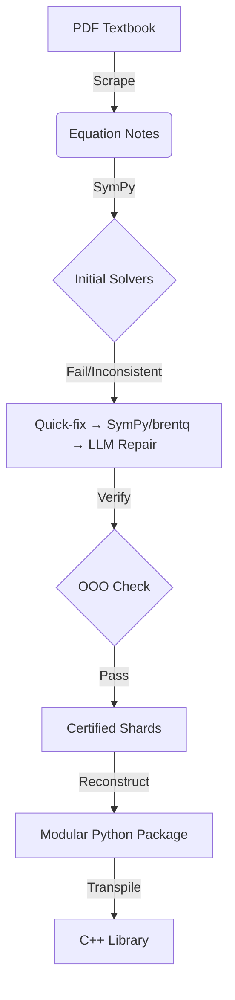

[Vakyume](https://github.com/juleshenry/vakyume) is a pipeline that reads the equations out of a textbook PDF and turns them into a tested Python package and a C++17 library. I built it around one book, the 1986 edition of *Process Vacuum System Design and Operation* by Ryans and Roper, which I had kept from a stint as a test technician at Applied Materials in Austin.

It works. All 148 equation families from that book verify in under a minute, and 623 of the 639 generated Python functions transpile to C++ that compiles cleanly. It also shows where a language model does not belong. The LLM repair step, the most elaborate part of the design, is never needed for the vacuum text and fixes nothing on a second book. The [results](#results) have the numbers.

## The Plan

The plan has five steps:

1. Extract the numbered equations from a PDF or a scanned book.
2. Convert each one to Python with SymPy, solving it for every variable it contains.
3. Where SymPy cannot isolate a variable, record a `SympyFailure` instead of guessing.
4. Hand each failure to a language model, and accept its code only once tests show it is correct.
5. Translate the finished Python into C++.

The goal is a general textbook-to-library tool, with Python as the intermediate product and C++ as the target for industrial use.



## Extraction

The scraper uses PyMuPDF and small local models (Phi-3, Llama-3) to find the numbered equations and their variables. Each equation is stored in a readable Python form, `lhs = rhs`. An interactive wizard picks the model and the chapters to process:

```
============================================================
  VAKYUME PDF Equation Scraper - Interactive Wizard
============================================================

  PDF: textbook.pdf

--- Model Selection ---
  Available Ollama models:
    [1] llama3:latest (default)
    [2] phi3:latest
    [3] llama3.2:latest

  Select model [1-3] (Enter for default):

--- Chapter Selection ---
  Found 28 chapters in PDF:

    [ 1] Introduction (12 pages)
    [ 2] The Scientific Method (8 pages) [auto-skip: non-equation content]
    [ 3] Kinematics (32 pages)
    ...

  Chapters to process: 10
```

The aim is not to read a PDF better than a large hosted model, which can already turn textbook pages into LaTeX. It is to own every stage and see what breaks between a scanned page and a compiled binary with nobody in the loop.

## Verification: One-Odd-Out

For any equation, say $PV=nRT$, Vakyume generates a solver for every variable ($P$, $V$, $n$, $R$, $T$). I wrote the [kwasak](https://github.com/juleshenry/vakyume/tree/main/sublibs/kwasak) library for the dispatch. The solvers for one equation form a family: `ABCDE(a=..., b=..., c=..., ...)` is backed by methods named `ABCDE__a`, `ABCDE__b` and so on, and calling the family with one keyword missing solves for that one.

The hard part is knowing whether a solver is right, particularly one written by a language model for a variable SymPy could not isolate. The procedure:

1. Propose dummy values for every variable, and try again if they are degenerate (0/0, for instance).
2. Solve for `a` from the others.
3. Feed that value of `a` back in and solve for each of the other variables in turn. If every solver returns the dummy value it started from, the family is consistent.

Two things complicate this. An equation can have several solutions. Positive real roots are usually the ones that matter for a physical vacuum system, but there are cases where every root is needed, complex ones included. So a solver may return a list, each element of which has to be tried against the other solvers, and the table of dummy arguments quietly changes from one float per variable to a list of floats per variable. And the procedure cannot start at all for an equation that has no solution at the values proposed.

This is the one-odd-out (OOO) check. Pick random inputs, solve for one variable, use the result to solve for the others, and flag the solver for repair if the results do not satisfy the original equation within a tolerance of $1 \times 10^{-4}$.

## Sharding

Each solver is isolated as a "shard": a standalone file with the right imports that can be loaded and called with dummy arguments on its own, so a solver that fails to run does not take the others down with it.

Sharding exposes a circularity in the check above. Take a family in which SymPy solved nothing and every shard came from a model. Shard 1 produces a value, shard 2 confirms it, and both are wrong in a compatible way. Shard 3 then disagrees with them and looks like the faulty one, when it may be the only correct one.

One answer is to look for value chains, sequences of shards whose outputs agree with one another on a set of dummy arguments, and to let those chains decide which candidate shards stand. In effect that is a consensus algorithm for formulas. It is not trivial to build, and it answers the wrong question. Shards vouch for each other only if nothing else can vouch for them, and something can: the equation. Plug every candidate root back into the original formula, check the residual, and each solver stands or falls on its own.

The v0.2 core in the repo does exactly that. It stores each equation once, peels off inverse operations to reach a closed form, and falls back to SymPy, then a numeric scan, only when it has to. The vacuum book's project, VacuumTheory, has 664 variables to solve for: 657 come out in closed form or as polynomial roots, four more via SymPy, and three need the scan.

## Repair

When a shard fails, Vakyume tries three things in order: a quick syntactic fix; a fresh SymPy solve, falling back to a bracketed `brentq` root-finder when SymPy times out or gives up; and only then a language model. The model receives the equation, a working shard from the same family, and concrete expected-versus-actual test cases, and returns a corrected solver.

The model runs through Ollama with structured prompts, and anything it returns still has to pass the OOO check.

Across the 156 algebraic equations in the notes, only one variable has no symbolic solution: `k` in equation 8-6, adiabatic horsepower, one of the three variables that need the numeric scan. The generated Python comes to 8,385 lines from 693 lines of notes, about twelve times as much code as input.

## Output

- **Python**: a modular package (`py/`) that uses the `@kwasak` decorator for automatic variable dispatch.
- **C++**: the Python AST transpiled to C++17, using `std::complex` and a custom `LambertW` implementation.
- **Documentation**: an Equation Certification Report (`docs/`) with LaTeX-rendered formulas and variable definitions, for review.

```text
projects/
└── VacuumTheory/
    ├── notes/           # Input: Equation definitions
    ├── shards/          # Intermediate: Individual solvers
    ├── reports/         # Analysis and verification logs
    ├── docs/            # Output: Equation Certification (LaTeX/MD)
    ├── py/              # Output: Modular Python package
    └── cpp/             # Output: C++ headers and source
```

The whole run is five commands, or one:

```bash
# 1. Scrape equations from a PDF
python3 vakyume.py scrape path/to/textbook.pdf -o projects/MyProject/notes

# 2. Run the pipeline: shard, verify, repair
python3 vakyume.py run projects/MyProject

# 3. Reconstruct verified shards into a Python package
python3 vakyume.py reconstruct projects/MyProject

# 4. Transpile to C++ and compile
python3 vakyume.py make-cpp projects/MyProject

# 5. Generate an Equation Certification Report
python3 vakyume.py make-docs projects/MyProject

# or all of it in one go, with whichever Ollama model you have pulled
python3 vakyume.py --llm-model qwen2.5:7b build projects/MyProject --pdf textbook.pdf
```

## Results
{: #results}

Here is `build` on two projects, with `qwen2.5:7b` loaded in Ollama and waiting to repair things. Both already have their notes, so this is shard → verify → repair → C++, not the scrape.

- **VacuumTheory**: all 148 families verify in 52 seconds. The Python package comes out at 787 methods (148 kwasak dispatchers and 639 solvers), 623 of the 639 solvers transpile to C++, and it compiles cleanly. The LLM is called zero times. Every broken shard is fixed by SymPy or a `brentq` fallback before the repair loop ever gets as far as Ollama.
- **BuildingModels**, a physics text: 43 of 49 families solve. Here the LLM is called: six shards, three tries each, eighteen answers, and none of them fixes anything. The equations themselves were mangled in extraction: `2L` for `2 * L`, a `K -` with nothing after the minus, `0.5 ** x ** 2` where a spring constant used to be. No solver, human or model, can be right about a wrong equation.

A dispatch bug in early kwasak is worth recording too. Sort keyword arguments alphabetically and pass them by position, and whenever a solver's parameters aren't in alphabetical order, values silently swap. That's a fine way to make a correct solver look wrong.

For the front of the pipeline, take a PDF it has never seen, Robert G. Brown's [Introductory Physics I](https://webhome.phy.duke.edu/~rgb/Class/intro_physics_1/intro_physics_1.pdf) from Duke, and read what comes back from the dropped-ball section. Seven equations: four are good physics (`y = -0.5 * g * t**2 + H`, `v_y = -g * t_g`), one is a differential step (`dy = -g * dt`) that passes as algebra, one is an integration constant (`D = H`), and the one that matters, time to hit the ground, comes out as `t_g = -((-2 * H) / g)**0.5` instead of $\sqrt{2H/g}$. The model also invents its own equation numbers, and they collide across chunks. A 661-page scrape at ten seconds a chunk does not change that.

## Where the Language Model Belongs

Rich Sutton's "[bitter lesson](http://www.incompleteideas.net/IncIdeas/BitterLesson.html)" is that general methods which scale with data and computation eventually beat systems built on hand-written rules. Vakyume is a hand-written system, and a general-purpose model can do much of the same job from a single prompt. For the handful of equations SymPy cannot solve, pasting them into a chat model and checking the answers by hand is faster than the machinery that automates it. The pipeline has too many failure modes and too much glue code to scale gracefully. What it teaches is symbolic math, AST manipulation, transpiling Python to C++, and how hard it is to verify generated code.

Verification can show a solver agrees with its equation. It can't show the equation agrees with the book. If an LLM belongs anywhere in this pipeline, it's at the front, reading the PDF, and that's exactly where it needs checking. Everywhere after that, it is never needed.
